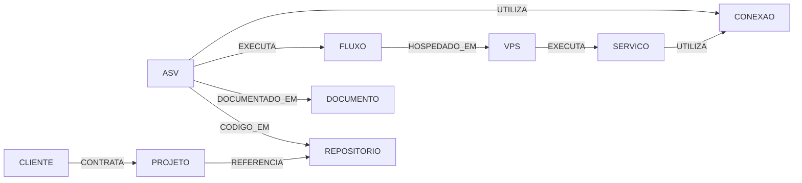

# Modelo conceitual de entidades e relacionamentos

O índice mestre liga os recursos existentes. Ele **não substitui** bases de dados especializadas.

## Entidades

| Tipo | ID de exemplo | Campos mínimos |
|---|---|---|
| ASV | `ASV-0001` | nome, função, plataforma, estado, responsável, documento mestre |
| Cliente | `CLI-0001` | nome, escopo, estado, responsável, workspace |
| Conexão | `CON-0001` | provedor, serviço, ambiente, finalidade, consumidores, cofre_ref |
| VPS | `VPS-0001` | provedor, proprietário, ambiente, capacidade, serviços, backups |
| Repositório | `REPO-0001` | URL canônica, origem, licença, proprietário, estado |
| Workflow | `FLUXO-0001` | sistema, workflow_id, ambiente, gatilhos, dependências |
| Documento | `DOC-0001` | tipo, URL/ID original, revisão, classificação, responsável |

Estes são formatos sugeridos, não registros reais.

## Relacionamento

## Integridade de registros

- Identificador interno **estável** e separado do ID externo (Google Drive, GitHub, n8n, provedores).
- Arestas com `origem_tipo`, `origem_id`, `destino_tipo`, `destino_id`, `tipo_relacao`, `evidencia`, `verificado_em`.
- Referências devem permitir consultas nos dois sentidos; não duplicar dados sensíveis do destino na origem.
- Nunca marcar vínculo como **confirmado** apenas porque existe plano, pasta ou menção documental.
- Registro de exclusão é evento auditável; não significa apagar automaticamente outros sistemas.
- Sincronização futura deve ser autenticada, idempotente, auditada e suportar reconciliação.

## Fichas mestre

Modelo estrutural disponível em `schemas/`: ASV, conexão, VPS, cliente e repositório. Os schemas contêm somente exemplos genéricos.
